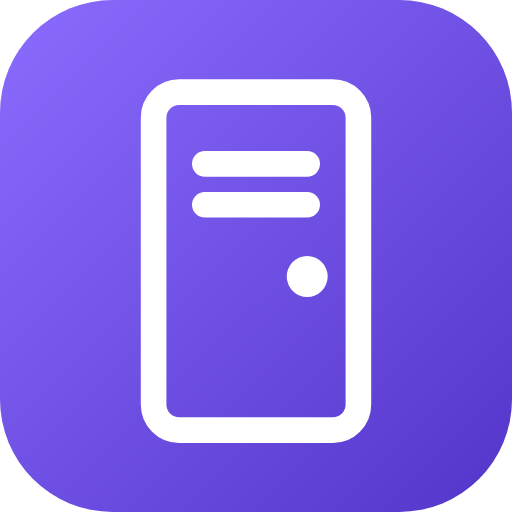

<p align="center"></p>

# homebridge-rozcom-door

[](https://paypal.me/orenasher)

English | עברית (below / למטה)

## English

Open your building's entrance door from Apple Home. The plugin exposes a Rozcom Smart Intercom door as a HomeKit Lock.

### Installation
1. In Homebridge UI go to Plugins, search for homebridge-rozcom-door and click Install.
2. Open the plugin Settings, fill in the fields, save, and restart Homebridge.

### Configuration
Add one door for each Rozcom door you want in Apple Home:
- name: name shown in Apple Home, e.g. Front Door
- mqttHost: MQTT broker address of your intercom system
- mqttPort: usually 1883
- topic: Intercom/BUILDING_ID/startcall
- payload: openDoor1:CODE (case sensitive)

```json
{
  "platform": "RozcomDoor",
  "name": "Rozcom Door",
  "doors": [
    { "name": "Front Door", "mqttHost": "62.219.14.161", "mqttPort": 1883, "topic": "Intercom/BUILDING_ID/startcall", "payload": "openDoor1:CODE" }
  ]
}
```

### Upgrading from 1.0.x
Version 1.1.0 is a platform plugin. An old setup under "accessories" keeps working as before, but the settings screen now shows the new platform setup. To move:
1. Copy your topic and payload from the old setup (Homebridge UI, JSON Config).
2. Delete the old RozcomDoor block from "accessories".
3. Open the plugin settings, add a door with the same values, save and restart.
4. The lock appears in Apple Home as a new accessory, so add it back to scenes and automations.

### Adding to Apple Home
1. After restarting Homebridge, open the Home app. If your Homebridge is already paired, the lock appears automatically.
2. If not: tap +, Add Accessory, scan the QR code from the Homebridge UI home page (or enter the PIN).
3. Tap the lock to open the door. It returns to Locked after 2 seconds.

### Finding your values
The values come from the Rozcom app's MQTT traffic. Capture it with mitmproxy in transparent mode while pressing the open-door button. Do this only for your own door and keep your building ID and code private.

## עברית

פתיחת דלת הכניסה של הבניין מאפליקציית הבית של אפל. הפלאגין מציג אינטרקום חכם של Rozcom כמנעול ב-HomeKit.

### התקנה
1. ב-Homebridge UI עבור ל-Plugins, חפש homebridge-rozcom-door ולחץ Install.
2. פתח את ההגדרות של הפלאגין, מלא את השדות, שמור והפעל מחדש את Homebridge.

### הגדרות
מוסיפים דלת לכל דלת של Rozcom שרוצים באפליקציית הבית:
- name: השם שיוצג באפליקציית הבית, למשל דלת כניסה
- mqttHost: כתובת שרת ה-MQTT של האינטרקום
- mqttPort: בדרך כלל 1883
- topic: Intercom/BUILDING_ID/startcall
- payload: openDoor1:CODE (רגיש לאותיות גדולות וקטנות)

### שדרוג מגרסה 1.0.x
גרסה 1.1.0 היא פלאגין מסוג platform. הגדרה ישנה תחת "accessories" ממשיכה לעבוד כרגיל, אבל מסך ההגדרות מציג עכשיו את ההגדרה החדשה. כדי לעבור:
1. מעתיקים את ה-topic וה-payload מההגדרה הישנה (Homebridge UI, ‏JSON Config).
2. מוחקים את בלוק RozcomDoor הישן מתוך "accessories".
3. פותחים את הגדרות הפלאגין, מוסיפים דלת עם אותם ערכים, שומרים ומפעילים מחדש.
4. המנעול יופיע באפליקציית הבית כאביזר חדש, אז צריך להוסיף אותו שוב לתרחישים ולאוטומציות.

### הוספה לאפליקציית הבית
1. אחרי הפעלה מחדש של Homebridge, פתח את אפליקציית Home. אם ה-Homebridge כבר מחובר, המנעול יופיע לבד.
2. אם לא: לחץ על +, הוסף אביזר, סרוק את קוד ה-QR מדף הבית של Homebridge UI (או הזן את ה-PIN).
3. לחץ על המנעול כדי לפתוח את הדלת. הוא חוזר למצב נעול אחרי 2 שניות.

### איך מוצאים את הערכים
הערכים נלקחים מתעבורת MQTT של אפליקציית Rozcom. אפשר ללכוד אותה עם mitmproxy במצב transparent בזמן לחיצה על כפתור הפתיחה. עשה זאת רק עבור הדלת שלך ושמור על מספר הבניין והקוד בסוד.

## Support

If this plugin saves you time, you can buy me a coffee: [paypal.me/orenasher](https://paypal.me/orenasher). Thank you!
